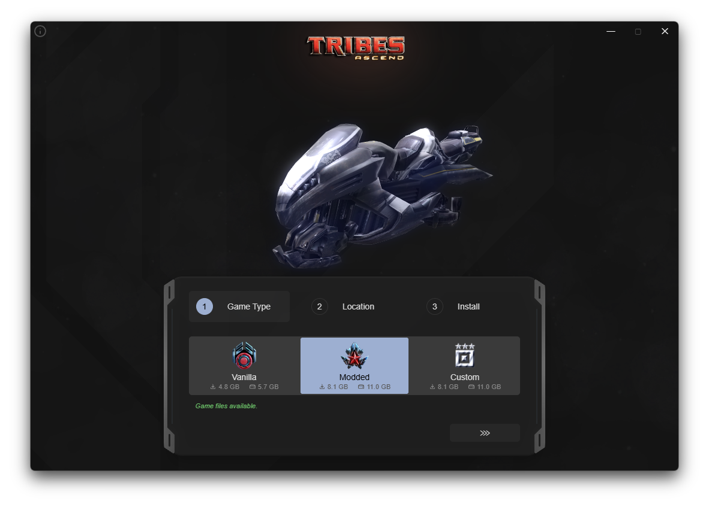
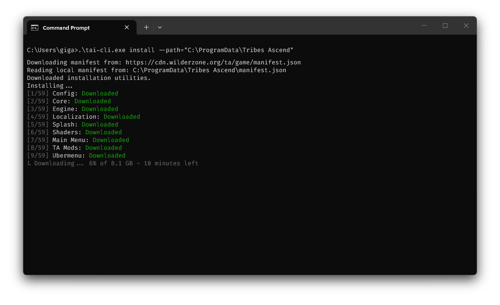

#  TA Installer

**A [CLI](https://en.wikipedia.org/wiki/Command-line_interface) and [GUI](https://en.wikipedia.org/wiki/Graphical_user_interface) utility for managing Tribes: Ascend installations.**

For detailed instructions on how to use TAI, and how it works, please see the [documentation website](https://wilderzone.org/docs/ta-installer).

## GUI

TAI GUI provides a simple, guided installation experience.

[Download](https://wilderzone.org/games/tribes-ascend) • [Learn more](https://wilderzone.org/docs/ta-installer)

  

## CLI

TAI CLI is provided as a means to install custom variants of TA, and for use in applications that require programmatic control of the TA installation process, such as launchers.

[Download](https://github.com/wilderzone/ta-installer/releases/latest) • [Learn more](https://wilderzone.org/docs/ta-installer/cli)

  

## Contributions

Please feel free to [open an issue](https://github.com/wilderzone/ta-installer/issues/new) or a pull request if you'd like to contribute.

Or get in touch via the [TA Community Hub Discord server](https://discord.gg/dd8JgzJ) if you have any questions.
